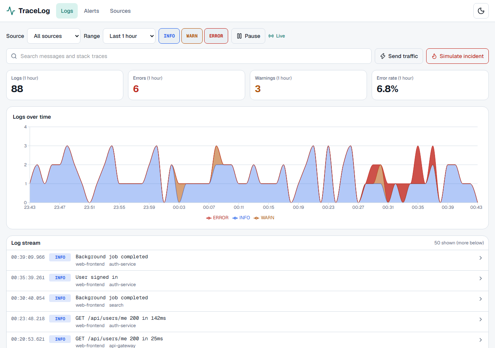
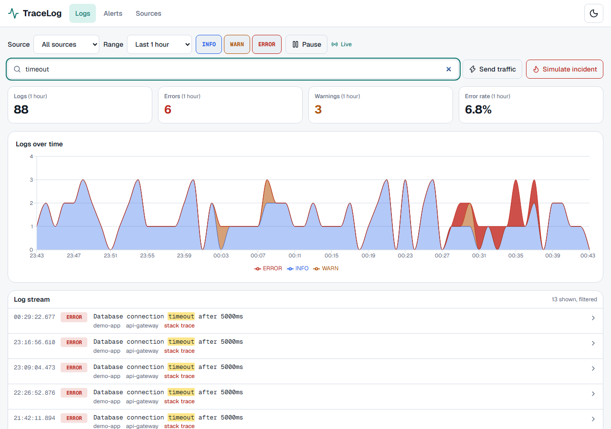
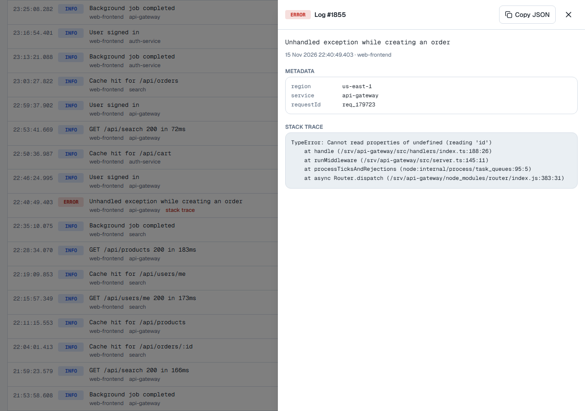
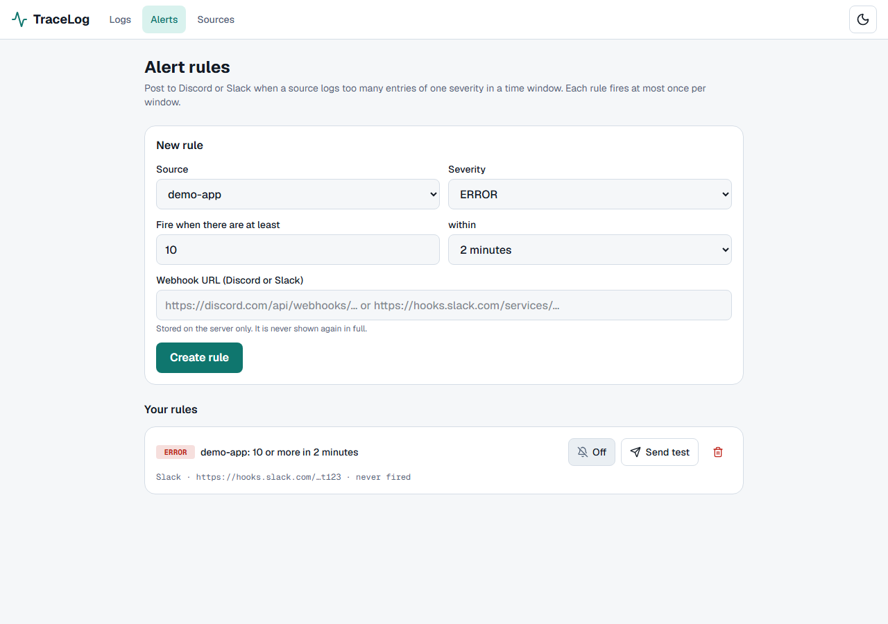
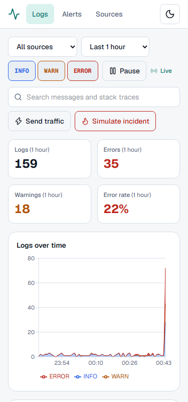

# TraceLog

A lightweight Datadog-style log monitor. Apps send logs to an API-key-protected ingestion endpoint; the dashboard streams them live, charts them by severity, searches them with highlighting, opens stack traces, and posts to Discord or Slack when errors spike.

**Live demo:** TBD (built and tested locally, not yet deployed)



## What to demo to a recruiter
- Open the dashboard (about 1,900 seeded logs over 24 hours, with error spikes, no sign-up) and press **Simulate incident**. New errors appear at the top within a couple of seconds and the chart and error rate jump. Press **Pause** and nothing moves until you resume.
- Type `timeout` in the search box: every match is highlighted, and a search like `(.*` is safely treated as plain text. Click an error to open its stack trace and metadata.
- Open **Sources**, create one, and copy its key (shown once, only a hash is stored). Send a log with the `curl` example on the page and watch it arrive live. Then look at **Alerts**: webhooks are validated, stored server-side, and never shown again in full.

## Features
- **Ingestion API:** `POST /api/ingest` with an `x-api-key` header. Batches of up to 500, strict validation, per-source rate limit (3,000 logs a minute), 401 for bad keys, 202 with a count.
- **Live dashboard:** a streaming list with severity filters, pause and resume, a stacked time-series chart, and totals with an error rate. New rows glow briefly.
- **Search:** case-insensitive substring search over messages and stack traces with in-line highlighting, safe against regex and SQL wildcard characters.
- **Detail drawer:** metadata, a copyable JSON view, and the full stack trace.
- **Sources:** several apps, each with its own key. Keys are shown once and stored as SHA-256 hashes, compared in constant time.
- **Alert rules:** "N or more ERRORs in a window" posts to Discord or Slack, at most once per window, with a test button.
- **Traffic simulator:** a button in the UI and `npm run simulate`, which sends batches over real HTTP the way an app would.
- Dark and light theme, keyboard accessible, responsive from 375px.

### Phase 2
- Saved searches
- A scheduled retention job (cleanup currently runs opportunistically as logs arrive)
- Sign-in, so each person only sees their own sources

## Stack
Next.js 16 (App Router), React 19, TypeScript (strict), Tailwind CSS 4, Recharts, Drizzle ORM with Neon Postgres, zod, Vitest.

## Architecture notes
- **Streaming without sockets.** Netlify Functions can't hold a connection open, so the browser polls `GET /api/logs?since=<id>`, 1.5 seconds apart (10 seconds when the tab is hidden, and immediately on resume). It is isolated in one hook, `useLogStream`, so swapping it for server-sent events later would not touch any component.
- **Cursor pagination, never OFFSET.** `logs.id` is a growing integer. `since` returns newer rows for the live view and `before` returns the next older page. Indexes on `(source_id, ts desc)`, `(severity, ts desc)` and `(source_id, id desc)` back every query.
- **Ingestion safety.** The key is checked before the body is read. Hashes are compared with `timingSafeEqual`. Batch size, message length, stack length and metadata keys are capped, timestamps from the future or older than a week are refused, and a per-source rate limit protects the database.
- **Alerts.** A rule fires when its source has logged at least `threshold` entries of its severity in `windowSec`. The rule is claimed with a single conditional `UPDATE ... RETURNING`, so two overlapping requests can never both send it (covered by a test that runs two evaluations at once).
- **Webhook safety.** Only real `discord.com/api/webhooks/...` and `hooks.slack.com/services/...` URLs are accepted, which blocks using a rule to make the server call an arbitrary or internal address (SSRF). Requests use a 5 second timeout and no redirects. The URL is a secret: the API only returns a masked copy, and test sends are limited to one per 30 seconds per rule.
- **A public demo, defended.** Because anyone can open it, source and rule counts are capped, the simulator is throttled, and old logs are deleted as new ones arrive so the database cannot fill up.
- **Tests.** 28 unit tests (keys, webhook validation, highlighting, buckets, the log generator, request schemas) and 14 integration tests against the real Neon database (auth, hashing, rate limiting, paging with no overlap or gaps, polling, search and severity filters, chart buckets, rule creation, firing once per window with `fetch` stubbed for the webhook host only). An automated browser run (36 checks) covers the live stream, filters, search, pause and resume, the ingestion API, sources, alert rules and mobile.

## Run locally
```bash
npm install
cp .env.example .env.local     # DATABASE_URL, DATABASE_URL_UNPOOLED, INGEST_KEY
npm run db:migrate             # create the tables
npm run db:seed                # 3 sources and about 1,900 logs over 24 hours
npm run dev                    # http://localhost:3003
npm run simulate -- --url http://localhost:3003 --batches 5 --mode errors   # send traffic over HTTP
```
Checks: `npm run typecheck`, `npm run lint`, `npm test`, `npm run build`.

## Screenshots
| Search | Stack trace | Alerts | Phone |
| --- | --- | --- | --- |
|  |  |  |  |

## Status
Built and tested locally. Deploy pending (needs `DATABASE_URL` and `INGEST_KEY` in Netlify's environment).
